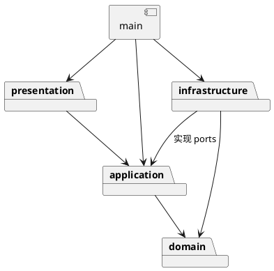

# Lab1 Phase 1 — 架构与开发记录

## 架构方案（实施前版本）

采用 TypeScript 面向对象实现，所有行为类一类一文件。领域层负责形状、树结构和不变量；应用层用 Command 封装操作并维护撤销重做；基础设施层实现 SVG/XML 与文件系统；表现层负责分词和 REPL。仅入口组装依赖。

| 目录 | 职责 |
| --- | --- |
| `src/domain/` | 六类图形、Composite、坐标及属性校验、树编辑 |
| `src/application/` | 会话、Command、历史记录、IO 端口、命令工厂 |
| `src/infrastructure/` | XML 编解码、文件系统端口实现 |
| `src/presentation/` | 引号分词、用户输入输出、逐行 REPL |
| `test/` | 功能、事务回滚、SVG 往返、CLI、依赖规则检查 |

### 设计模式与依赖规则

- **Command（必选）**：每种命令独立类，统一执行入口；一次编辑提交一个历史单元。
- **Composite**：Group 和叶子遵循相同 Shape 操作接口；容器递归移动、缩放，样式遵循 SVG 继承。
- **Memento**：事务前后保存深拷贝；在候选文档上执行并校验，成功后替换当前文档，失败不改文档、路径或历史。
- **Factory**：命令名称映射仅位于 CommandFactory；类型名称映射仅位于 ShapeFactory。两处集中注册表是后续插件化阶段待重构点，不到处做 tag 分支。
- **依赖倒置**：应用只认识文档存储端口，文件 IO、XML 库与终端均留在外层。
- domain 不依赖其他项目层、Node IO 或第三方库；application 仅依赖 domain 与本层；presentation 仅依赖 application；infrastructure 可依赖 application/ports、domain；main 为唯一装配入口。

### 变化点假设

1. 新增图形和插件：保留 Shape 多态与工厂集中入口，本阶段不实现插件加载和 box。
2. GUI/agent 输入：复用应用会话与命令，替换 presentation。
3. 持久化格式：替换存储端口，领域无需知道 XML。
4. 大文档撤销内存：先采用可靠快照，后续可替换增量历史；本阶段优先验证失败原子性。
5. 外部 SVG 的变换和扩展属性：范围需与用户确认，不静默删除未知内容。

## 过程记录

- 2026-11-16：阅读原任务。发现跨父级 group 的插入位置、外部 transform 支持范围未明，已向用户提问。明确根级 ungroup 按规格拒绝、box 不属于本阶段。
- 初始目录为空，建立独立 Git 工程。远程仓库、提交署名和截止时间等待用户提供；不虚构讨论、测试或远程提交结果。

## 一致性自查

实施完成后据实际代码填写。

## 质量保证手段

将通过严格 TypeScript 编译、规格案例、失败原子性与历史栈测试、文件往返、真实 CLI 回放以及依赖方向检查进行验证。最终结果待执行后记录。
