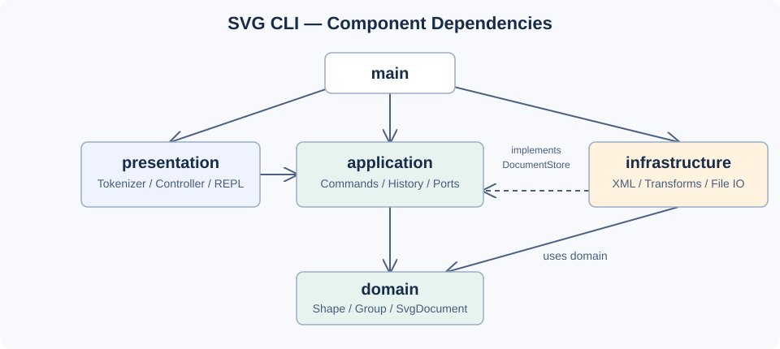
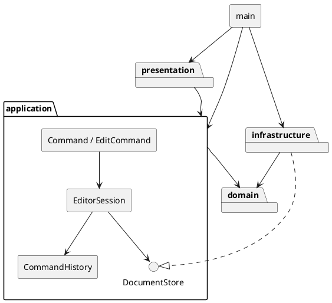

# Lab1 Phase 1：架构与开发记录

学号：**26213050215** · Git 署名邮箱：`hanjiang26@m.fudan.edu.cn`。

## 架构方案

### 模块划分

采用 TypeScript 严格模式和面向对象范式。一类一文件，文件名与类名一致；形状和树结构封装自己的状态与行为。XML 中间对象和端口返回值仅用于数据传输，不承担领域行为。

| 模块                        | 主要类                                                                                                         | 职责                                                 |
| --------------------------- | -------------------------------------------------------------------------------------------------------------- | ---------------------------------------------------- |
| `src/domain/`               | Shape、GeometryShape、Rect/Circle/Ellipse/Line/TextShape、Group、ChildList、SvgDocument、ShapeFactory、Numeric | 六类图形、多态、树结构、几何校验、分组与顺序等不变量 |
| `src/application/`          | EditorSession、CommandHistory、HistoryEntry、CommandFactory、Arguments、DocumentPresenter                      | 当前文档、事务、历史、用例、文本展示                 |
| `src/application/commands/` | Command、EditCommand、各具体命令类                                                                             | 每种命令独立对象，统一执行接口                       |
| `src/application/ports/`    | DocumentStore（接口）                                                                                          | 应用所需的持久化契约                                 |
| `src/infrastructure/`       | SvgCodec、UniformTransform、FileDocumentStore                                                                  | XML 解析与序列化、变换折算、文件 IO                  |
| `src/presentation/`         | Tokenizer、EditorController、Repl                                                                              | 分词、错误边界、逐行终端交互                         |
| `src/main.ts`               | 装配入口                                                                                                       | 创建对象并注入依赖，无领域逻辑                       |
| `test/`                     | 功能测试及 ArchitectureCheck                                                                                   | 行为验证、回归与依赖规则检查                         |



对应的 [PlantUML 源码](architecture.puml)：



### 设计模式的选择与落地

**Command（要求必选）**：`Command.execute(session)` 是统一入口。每个具体命令有独立类，例如 MoveCommand、GroupCommand。所有编辑继承 EditCommand，由其将领域操作交给 EditorSession 的事务入口；读取、保存、显示、undo/redo 也采用命令对象，但执行不同用例。CommandFactory 是唯一命令名称分派点。

**Composite**：Group 与叶子都是 Shape，对 `move/scale/set` 使用同一个接口。Group 在内部递归移动与缩放子形状；客户端不根据 tag 判断叶子类型。几何行为封装于 GeometryShape，具体类型定义自己的坐标维度及展示。容器能力通过 `asContainer()` 多态表达，叶子对容器操作明确报错。Group 和 SvgDocument 使用 ChildList 封装子节点顺序与父指针。

**Memento**：EditorSession 在文档副本上执行编辑，校验成功后才记录 HistoryEntry 并替换当前文档；条目保存独立的前后快照。撤销恢复前状态，重做恢复后状态。因此 group/delete/ungroup 等整棵子树操作天然对应一个历史单元，数值溢出或后续校验失败也不会留下部分变更。撤销消息以 `undone:` 描述被撤销的操作；可用 tree/show 查看恢复状态。

快照代价是每次编辑 O(N) 的复制及校验、H 条历史约 O(H×N) 内存。当前教学规模优先保证可理解性与正确性，不把增量历史、持久化数据结构或复杂索引提前引入。

**Factory**：ShapeFactory 统一使用内置定义完成 CLI 创建与 SVG 导入；CommandFactory 统一注册命令。按图形类型名、命令名的分派分别只出现在这两个入口，不存在遍布系统的 `switch(tag)`。**这两处内置注册表标记为后续插件化阶段的待重构点**：将来改为外部 Provider 注册；本阶段不实现插件发现、生命周期和 box。

**依赖倒置（架构原则）**：EditorSession 只依赖 DocumentStore 接口。FileDocumentStore 实现文件操作，测试使用内存实现。核心应用不导入 fs、XML 库或终端 API。没有仅为了使用模式而增加 Singleton 或事件总线。

### 依赖方向规则

| 来源           | 允许依赖                                                         | 理由                                     |
| -------------- | ---------------------------------------------------------------- | ---------------------------------------- |
| domain         | domain                                                           | 领域不认识 CLI、XML 或磁盘               |
| application    | application、domain                                              | 用例编排领域操作，通过本层端口请求持久化 |
| presentation   | presentation、application、Node 终端/流 API                      | 解析交互、调用用例，不操纵领域细节       |
| infrastructure | infrastructure、domain、application/ports、Node 文件 API、xmldom | 在边界转换格式并实现端口                 |
| main           | 所有装配所需外层                                                 | 唯一组合根                               |
| test           | 被测模块、测试工具                                               | 验证各层契约，不属于产品依赖             |

反向依赖或基础设施依赖具体应用用例类属于待处理项。ArchitectureCheck 用 TypeScript AST 检查源码导入、类名/文件名、一类一文件和顶层自由函数；动态行为和模式适用性仍需人工阅读。

### 变化点假设

1. **新图形/插件**：保留 Shape 多态、ShapeFactory 集中入口与序列化属性接口；目前只注册六类。未实现 box 插件，也不声称以后无需任何内核改动。
2. **GUI 或 agent 通道**：复用 EditorSession、Command 和领域层；替换 Tokenizer/Repl，核心不接触标准输入输出。
3. **存储或格式**：替换 DocumentStore 实现即可切换持久化。SVG XML 的兼容性演进集中在 SvgCodec 与 UniformTransform。
4. **更大规模文档**：可替换 CommandHistory 的快照策略；当前不增加复杂 ID 索引，遍历查找便于保持唯一性和树结构一致。
5. **更广 SVG 支持**：旋转、非等比缩放、路径、CSS、混合文本和复杂 viewBox 会改变几何语义，当前明确拒绝。将来应先设计变换与样式模型，不通过忽略属性来伪装兼容。

### 用户确认的语义及实现补充

- 跨父级 group：采用最近公共祖先；在最早所选分支前插入；组内按原文档深度优先次序排列。禁止同时选择容器及其子孙；保留空原容器。
- 导入变换：支持嵌套 translate 和正数等比 scale，遵循 SVG 变换组合顺序，折算到几何值。文本大小和线宽按有效继承值及默认值折算；组结构保留。
- 根级 ungroup 的拒绝来自作业原文，即使常见编辑器允许也保持此规则。嵌套 ungroup 占据原组位置，并将必要的组样式补到无显式覆盖的直接子节点，保留外观。
- 不同于导入变换，CLI scale 按原文只乘几何属性，不改变字体大小或线宽。
- ID 自动分配先扫描整个 SVG 的显式 ID（含根 ID），然后按元素类型从 1 向上找未占用值；避免先补出的 ID 与后面的显式 ID 冲突。警告只有在整个 read 成功后才输出。
- 成功的 IO 命令清空并锁住历史。失败不会改变历史、文件路径或文档；新的成功编辑重新解锁。canvas 查询不算 IO 屏障。
- 保存先写同目录临时文件，再 rename 到目标；失败清理临时文件。保存成功后才更新默认路径并清空历史。
- 属性缺省遵循 SVG；常用字体呈现属性可导入保存，但 `set` 严格执行作业白名单。未知 `data-kind` 保留标记并作为普通 g 使用。
- 补充参数约定、错误/退出码、外部 SVG 支持范围见根 README。

## 过程记录

以下记录本次实际发生的决策、验证和修改，不虚构学生手写代码或未进行的人工评审。

| 阶段       | 发现与证据                                                                        | 决策或修正                                                                                                       |
| ---------- | --------------------------------------------------------------------------------- | ---------------------------------------------------------------------------------------------------------------- |
| 需求阅读   | 原文未规定跨父级 group 的新组位置；开头展示 transform，但命令模型强调直接改几何值 | 向用户提问；用户确认最近公共祖先规则和有限变换支持，将规则写入实现与测试                                         |
| 版本管理   | 初始目录和远程仓库均为空                                                          | 建立独立工程，先提交架构与配置，再提交领域层，后续逐步提交命令、IO、测试、文档；没有倒造提交时间                 |
| 署名与期限 | 用户提供学号、邮箱、远程仓库以及 2026-10-31 截止时间；当前为 2026-11-16           | 用户确认按逾期作业继续，使用真实时间。不能满足“截止前 final 标签”这一时间要求                                    |
| 领域层     | 严格编译指出父容器接口直接断言为 Shape 不安全                                     | 改为查找选中祖先对象后使用其 ID，领域测试通过                                                                    |
| 事务模型   | 递归 scale 可能先改小数值节点，之后在大数值节点发生 Infinity 溢出                 | 在文档副本上执行；测试验证失败后原文档和 redo 均保持不变                                                         |
| 自动 ID    | 顺序补 ID 可能与 SVG 后面的显式 rect1 冲突                                        | 先预留全文显式 ID，再分配，增加冲突与重复 ID 测试                                                                |
| 变换与文本 | 只缩放 x/y 会丢失文本大小和线宽效果，尤其是从父节点继承的默认值                   | 折算有效字体大小、线宽并测试嵌套变换及往返；CLI 几何缩放仍按规格执行                                             |
| XML 往返   | 首次特殊字符测试中内嵌引号被测试字符串自身转义吞掉                                | 检查实际传入 CLI 的字符，改用 String.raw 保留反斜线；验证中文、XML 字符与双引号均能往返                          |
| 集成验证   | 内存测试不足以验证读写权限、磁盘原子替换和连续异步命令                            | 加入临时目录中的真实 IO、只读文件、CLI 子进程和示例回放测试                                                      |
| 可维护性   | 初版存在较密集的一行实现及未使用的领域呈现缩放方法                                | 统一格式化并删除未使用方法，呈现变换留在基础设施层；加入格式与架构自动检查                                       |
| 远程提交   | 首次 HTTPS 推送无凭据；SSH agent 无可用身份                                       | 用户选择由 AI 准备 GitHub 官方浏览器授权流程，登录确认由用户完成，已观察到 GitHub 授权成功页面并确认仓库写入权限 |

## 一致性自查

### 1. 模块划分

实际目录与初始方案一致。补充的 `application/commands`、`application/ports` 是原方案模块内部细分，没有引入新层。DocumentPresenter 位于 application，因为它读取领域状态并产出纯文本；表现层只处理终端协议。最终代码共 48 个产品 TypeScript 文件（包括接口和装配入口），每个行为类一类一文件。

开发期间的修订已记录：明确分组位置、变换边界、ID 预留、保存原子替换和导入呈现值。插件化、增量撤销和完整 SVG 支持保留为变化点，未夸大为已实现能力。

### 2. 依赖方向

自动检查通过，未发现规则违反。抽样：

- `Group.ts` 只导入领域层 Shape、ChildList、Numeric、ShapeParent。
- `EditorSession.ts` 导入领域 SvgDocument、本层历史与 DocumentStore 端口，不导入 fs 或 XML 库。
- `FileDocumentStore.ts` 导入 DocumentStore 接口、领域类型和 Node IO；XML 逻辑交给 SvgCodec。
- `EditorController.ts` 只导入应用会话、命令工厂和同层分词器，不按形状标签分派。
- `main.ts` 是 FileDocumentStore、EditorSession、EditorController 与 Repl 的唯一产品装配处。

## 质量保证手段

可复现入口：

```sh
npm ci
npm run check
```

检查链包含严格 TypeScript 编译、Node 原生测试、AST 架构检查和 Prettier 格式检查。已执行的 35 项测试均通过；部分测试内部验证多条操作与所有中间快照。测试关注外部可观察行为及风险边界，不仅复述实现。

| 验证层次   | 实际覆盖                                                                                               |
| ---------- | ------------------------------------------------------------------------------------------------------ |
| 领域       | 六种图形、默认样式、大小写 ID、数值约束、Composite、分组顺序、循环拒绝、提升与层叠                     |
| 命令/会话  | 全部命令类别、引号与注释、精确错误消息、undo/redo 分叉、查询不改历史、成功 IO 屏障                     |
| 失败原子性 | 溢出后的部分递归修改、缺失分组目标、非法尺寸、读写失败、失败后 redo 与路径保持                         |
| XML        | 六类往返、中文与转义、预留 ID、重复 ID、嵌套变换、继承字体/线宽、未知 data-kind 降级                   |
| 非支持输入 | 非法 XML、多个根、实体、DTD、未知元素/命名空间、旋转、非等比缩放、复杂 viewBox、CSS、tspan、叶子子节点 |
| 文件/CLI   | 真实保存读取、只读文件、缺失目录、临时文件清理、连续 IO、脚本失败退出码、流程图 8 元素输出             |
| 长序列     | 160 条混合编辑，每一步完整撤销并逐一比较，再完整重做并比较所有状态                                     |
| 结构       | 48 个源码文件的依赖方向、类名文件名、顶层自由函数与格式检查                                            |

另做实际渲染检查：流程图的两个节点、文字与连线均正常；任务示例中的嵌套 translate/scale，在导入折算前后使用相同渲染器比较，320,000 个 RGBA 通道完全相同（差异为 0）。交互式 PTY 中已观察到启动信息、`svg>` 提示符以及 Ctrl-D 正常退出。

测试不代表覆盖完整 SVG 标准或任意超大/极深文档；支持边界已明确列出。快照历史和递归遍历适合当前实验规模。保存采用原子替换，但没有文件系统断电级 fsync 保证。

## 提交说明

远程仓库：<https://github.com/chinacodeking/svg>。最终检查通过后在最终提交创建 annotated tag `final`，并推送 main 与该标签。可用以下命令核验分阶段历史、最终版本和真实时间：

```sh
git log --oneline --decorate
git show --no-patch --format=fuller final
git ls-remote origin refs/heads/main 'refs/tags/final*'
```

原截止时间 2026-10-31 已过去；用户已明确同意按逾期作业继续。未修改系统时间、作者时间或标签时间。
